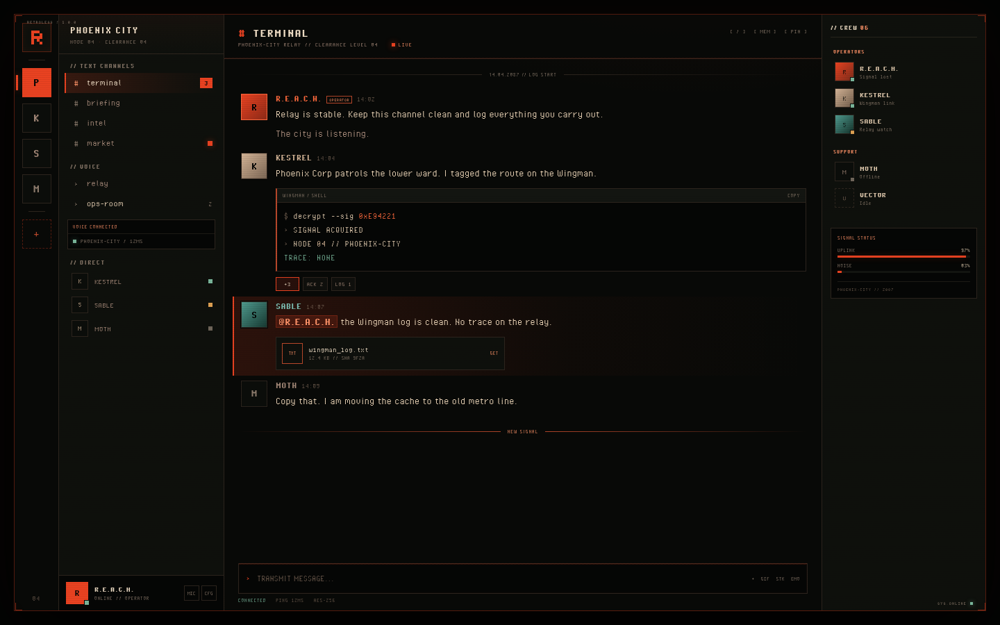

# RETROLESS

Tema de Discord inspirado en REPLACED. Naranja de señal, tipografía Pixel Operator, paneles rectos, scanlines, grano y bordes tramados. Hecho para Vencord y Equicord.


## Resumen

RETROLESS traslada el lenguaje visual de los menús de REPLACED a Discord:

- Un único naranja de señal tomado del menú de pausa: `#E94221`
- Tipografía píxel para títulos, cuerpo y monoespaciado
- Geometría recta, reglas de un píxel y esquinas marcadas
- Capa CRT fija: scanlines, grano, viñeta y corchetes
- Cobertura completa: chat, servidores, miembros, perfiles, ajustes, modales, menús, pickers, voz y ajustes de Vencord
- Animación de menús estilo REPLACED: barrido de terminal de izquierda a derecha, entrada escalonada, glitch al pasar el cursor, barrido y pulso de badges
- CSS modular cargado directamente desde GitHub raw
- Soporte para movimiento reducido

No incluye arte del juego. La marca, el skyline, el grano y las esquinas son originales.

## Notas de referencia

- Menú principal: fondo negro, wordmark rojo-naranja tramado y una sola fila de opciones en mayúsculas.
- Pantalla de pausa: el mismo naranja de señal en título y acciones, sin cajas, tracking amplio y versión en la esquina inferior.
- Dispositivo Wingman: reproductor de lore diegético inspirado en la Game Boy Camera, el Walkman y el iPod de primera generación; LCD color papel, etiquetas naranjas, bisel y sombra en teal profundo.
- Arte del mundo: sombras teal profundas contra luz naranja intensa, con grano y scanlines marcados.

Esas observaciones guían la paleta, la escala tipográfica, la geometría de paneles y la capa CRT. El objetivo es una interfaz usable de Discord, no una copia literal del juego.

## Vista previa



## Instalación

`Retroless.theme.css` es un único archivo autocontenido: las fuentes, los iconos y las texturas van embebidos, así que no carga nada más.

### Online (se actualiza solo)

1. Abre los ajustes de Discord.
2. Ve a `Vencord` -> `Themes` -> `Online Themes`.
3. Pega esta URL en una línea:

```text
https://raw.githubusercontent.com/leriart/Retroless/main/Retroless.theme.css
```

4. Activa `RETROLESS`. Reinicia Discord si la interfaz no se refresca.

Si una actualización no aparece, añade una versión a la URL, por ejemplo `?v=2.0.0`, o cierra Discord por completo desde la bandeja y vuelve a abrirlo.

### Descarga

1. Descarga [`Retroless.theme.css`](https://raw.githubusercontent.com/leriart/Retroless/main/Retroless.theme.css) (clic derecho -> `Guardar enlace como`), o usa el botón de descarga de la página, que además puede dejar tu color de acento ya aplicado.
2. Abre `Vencord` -> `Themes` -> `Local Themes` -> `Open Themes Folder` y suelta ahí el archivo.
3. Activa `RETROLESS`. Funciona sin conexión.

## Color de acento

Todo el naranja de la interfaz sale de una sola variable. Pon esto en `Vencord` -> `Themes` -> `QuickCSS` para recolorear el tema entero:

```css
:root {
    --rl-accent: #3ddc97;
}
```

Selecciones, bordes, brillos, iconos, insignias, la marca de arranque y los tokens de marca de Discord la siguen.

## Conflictos entre temas

Usa RETROLESS como único tema. ClearVision, Midnight, System24, Ryoku, Selene y otros temas completos sobrescriben las mismas variables de Discord y se mezclan con este, produciendo texto oscuro sobre fondos oscuros, buscadores claros o iconos redondeados.

Usa también la apariencia `Dark` o `Darker` de Discord. RETROLESS fuerza superficies oscuras, pero el modo claro puede filtrarse en componentes nativos.

Instala RETROLESS desde `Online Themes` o `Local Themes`. No pegues el tema completo en QuickCSS; usa QuickCSS solo para sobrescribir tokens.

## Movimiento

Los menús contextuales y modales abren con un barrido CRT por pasos. Los elementos del menú entran en secuencia, hacen glitch al pasar el cursor y reciben un barrido corto. Los canales y servidores seleccionados parpadean una vez, y los badges de no leídos pulsan. Todo se desactiva automáticamente con `prefers-reduced-motion: reduce`.

```css
:root {
    --rl-menu-duration: 190ms;
    --rl-item-duration: 150ms;
    --rl-glitch-duration: 220ms;
}
```

## Iconos

El tema incluye 61 iconos pixel originales de 16 x 16. Reemplazan los SVG de Discord en la lista de canales, barra del chat, panel de usuario, caja de mensaje, controles de servidor y acciones comunes mediante máscaras CSS. Si un botón no tiene icono mapeado, usa un diamante pixel como fallback. La galería está en `docs/icons.html`.

Los avatares de contactos son imágenes del usuario, así que no se pueden reemplazar con máscaras. RETROLESS los fuerza a cuadrado, añade un marco de un píxel, aplica un filtro cálido de contraste moderado y una scanline sutil:

```css
:root {
    --rl-avatar-filter: saturate(0.78) contrast(1.1) sepia(0.2) brightness(0.96);
    --rl-avatar-scanline: 0.14;
}
```

Pon `--rl-avatar-filter: none` o `--rl-avatar-scanline: 0` para desactivar cada efecto.

## Arranque

Vesktop permite una imagen de splash personalizada desde `Vesktop` -> `Ajustes` -> `Customize App Assets` -> `Splash`. Elige `assets/brand/splash.gif` (animado) o `assets/brand/splash.png` (estático) y activa `Nearest-Neighbor Scaling (for pixel art)`. Mantén el fondo oscuro y el texto crema/naranja.

El tema también reemplaza la pantalla de carga interna de Discord: oculta el logo y el spinner, y los sustituye por la R pixel, un pulso de scanline y `SIGNAL BOOT // PHOENIX-CITY`.

## Sonidos

Los temas son solo CSS y no pueden reproducir audio, así que de los sonidos se encarga `RetrolessSounds`, un pequeño userplugin de Vencord en `plugin/retrolessSounds`. Sustituye los sonidos propios de Discord (mensajes, menciones, silenciar, ensordecer, entrar, salir, llamadas, directos, cámara, pulsar para hablar, actividades) por el pack de señal de RETROLESS y añade sonidos de interfaz: ticks al pasar el cursor, seleccionar, volver, navegar, interruptores, abrir y cerrar menús, teclear y enviar.

El pack de `sounds/` es audio original sintetizado e inspirado en REPLACED. No incluye ni redistribuye audio del juego. Es CC0; cambia cualquier WAV por el tuyo usando el mismo nombre.

### Vesktop (Linux)

```bash
git clone https://github.com/leriart/Retroless.git
cd Retroless
./scripts/install-sounds.sh
```

El script compila Vencord con el plugin y apunta Vesktop a esa compilación. Reinicia Vesktop y activa `RetrolessSounds` en `Ajustes` -> `Plugins`. Ejecútalo otra vez para actualizar, o con `--uninstall` para volver a la compilación original.

### Cualquier Vencord compilado desde el código

Copia `plugin/retrolessSounds` en `src/userplugins/` de tu copia de Vencord y ejecuta `pnpm build` y `pnpm inject`.

En los ajustes del plugin puedes desactivar los sonidos sustituidos de Discord, los de interfaz, los ticks de cursor, los de teclado y la señal de arranque, y ajustar el volumen. El mapeo de eventos está en `sounds/manifest.json`; hay una vista previa en `docs/sounds.html`. En Equicord puedes subir los WAV en su plugin `CustomSounds`.

## Paleta

| Token | Hex | Origen |
| --- | --- | --- |
| Naranja de señal | `#E94221` | Menú de pausa / logo |
| Óxido | `#A8231B` | Sombra del logo |
| Papel Wingman | `#D4B496` | Interfaz del dispositivo |
| Teal de canal | `#14322A` | Tonos de sombra |
| Teal profundo | `#051F1C` | Bisel del dispositivo |
| Vacío | `#050605` | Base de superficie |

Estados:

| Estado | Hex |
| --- | --- |
| En línea | `#79B59A` |
| Ausente | `#DDA052` |
| No molestar | `#FF4626` |
| Desconectado | `#6F655A` |

## Personalización

Sobrescribe los tokens desde QuickCSS de Vencord. La paleta completa vive en `src/00-tokens.css`.

```css
:root {
    --rl-signal: #ff5a2e;
    --rl-signal-hot: #ff7a4f;
    --rl-panel: #10120e;
    --rl-line: #33271f;
    --rl-scanline-opacity: 0.35;
    --rl-grain-opacity: 0.22;
    --rl-vignette-opacity: 0.8;
}
```

| Variable | Valor | Efecto |
| --- | --- | --- |
| `--rl-signal` | `#e94221` | Acento principal, selección, badges |
| `--rl-signal-hot` | `#ff6a3d` | Hover y foco |
| `--rl-paper` | `#d4b496` | Texto secundario cálido |
| `--rl-bone` | `#e4cdb1` | Texto de cuerpo |
| `--rl-panel` | `#0e100c` | Barras laterales y tarjetas |
| `--rl-ink` | `#080907` | Chat y superficie principal |
| `--rl-void` | `#050605` | Fondo profundo e inputs |
| `--rl-line` | `#2c241d` | Bordes y reglas |
| `--rl-scanline-opacity` | `0.25` | Intensidad de scanlines |
| `--rl-grain-opacity` | `0.18` | Intensidad del grano |
| `--rl-vignette-opacity` | `0.55` | Intensidad de la viñeta |
| `--rl-flicker-duration` | `0s` | `9s` activa un parpadeo sutil |
| `--rl-font` | Pixel Operator | Tipografía de cuerpo e interfaz |
| `--rl-font-mono` | Pixel Operator Mono | Código y timestamps |
| `--rl-radius` | `0px` | Radio de componentes por token |
| `--rl-avatar-filter` | filtro CRT cálido | Filtro aplicado a avatares de contactos |
| `--rl-avatar-scanline` | `0.14` | Scanline sobre avatares |

Para quitar el efecto CRT:

```css
:root {
    --rl-scanline-opacity: 0;
    --rl-grain-opacity: 0;
    --rl-vignette-opacity: 0;
}
```

## Estructura

```text
Retroless/
├── Retroless.theme.css      tema compilado, autocontenido
├── src/
│   ├── 00-tokens.css        paleta, tipografía, efectos
│   ├── 01-fonts.css         fuentes Pixel Operator
│   ├── 02-tokens-discord.css
│   ├── 03-base.css
│   ├── 04-shell.css
│   ├── 05-navigation.css
│   ├── 06-chat.css
│   ├── 07-members.css
│   ├── 08-controls.css
│   ├── 09-overlays.css
│   ├── 10-settings.css
│   ├── 11-effects.css
│   ├── 12-priority.css
│   ├── 13-motion.css
│   ├── 14-icons.css
│   ├── 15-boot.css
│   └── 16-replaced.css
├── assets/
│   ├── brand/               marca, esquinas, grano, skyline
│   ├── fonts/               Pixel Operator (CC0)
│   └── icons/               iconos pixel originales 16x16
├── sounds/                  signal pack (CC0) + manifest
├── docs/                    landing y preview
├── scripts/                 validación, bundle, generador de sonidos
└── LICENSE
```

## Desarrollo

```bash
npm install
npm run check
npm run build
npm run serve
```

- `npm run check` valida assets y sintaxis CSS, y que `Retroless.theme.css` coincida con `src/`.
- `npm run build` empaqueta `src/` e incrusta fuentes, iconos y texturas en `Retroless.theme.css`. Ejecútalo tras cada cambio en `src/`.
- `npm run serve` sirve el repositorio en `http://127.0.0.1:8123`.
- Preview: `http://127.0.0.1:8123/docs/preview.html`
- Landing: `http://127.0.0.1:8123/docs/index.html`
- Sonidos: `http://127.0.0.1:8123/docs/sounds.html`

La base raw está definida en `Retroless.theme.css` y `scripts/build.mjs`. Cambia ambas si haces un fork.

## Compatibilidad

- Vencord
- Equicord
- Vesktop
- Discord desktop

Discord web no es objetivo. Las clases de Discord pueden cambiar entre versiones; el tema usa atributos de datos y prefijos estables cuando es posible.

Pixel Operator cubre glifos latinos. Otros alfabetos usan el fallback normal de Discord.

## Créditos

- Código del tema: Apache-2.0
- Pixel Operator de Jayvee Enaguas (HarvettFox96): CC0 1.0, licencia en `assets/fonts/LICENSE-PixelOperator.txt`
- Paleta tomada de capturas de menú de REPLACED
- Referencia de diseño: [Game Developer / The Wingman](https://www.gamedeveloper.com/design/replaced-wingman)
- Página oficial: [playreplaced.com](https://playreplaced.com/)
- REPLACED es un juego de Sad Cat Studios, publicado por Thunderful
- Proyecto fan no oficial. Sin afiliación con Sad Cat Studios ni Thunderful. No incluye assets del juego.
