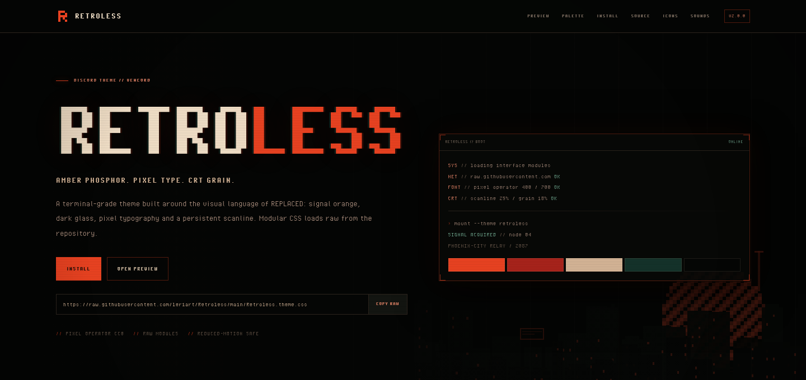
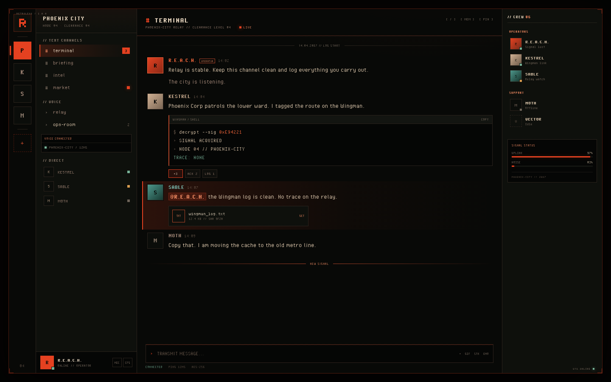

# RETROLESS

A REPLACED-inspired terminal for Discord. Signal orange, Pixel Operator type, square panels, scanlines, grain, and dithered edges. Built for Vencord and Equicord.



## Overview

RETROLESS takes the visual language of REPLACED's menus and translates it into a complete Discord skin:

- A single amber signal color sampled from the pause menu: `#E94221`
- Pixel typography for display, body, and monospace text
- Square geometry with one-pixel rules and notched accents
- A fixed CRT layer: scanlines, film grain, vignette, corner brackets
- Full Discord coverage: chat, guild rail, member list, profiles, settings, modals, menus, pickers, voice, and Vencord settings
- REPLACED-style menu motion: left-to-right terminal wipe, staggered entries, glitch hover, scan sweep and badge pulse
- Modular CSS, loaded directly from GitHub raw
- Reduced-motion support

No game art is bundled. The mark, skyline, grain, and corner assets are original.

## Reference notes

- Main menu: black field, a dithered red-orange wordmark, and a single row of uppercase menu items.
- Pause screen: the same signal orange for the title and actions, no boxes, wide tracking, version string in the lower corner.
- Wingman device: a diegetic handheld lore player inspired by the Game Boy Camera, Walkman, and first-generation iPod; warm paper LCD, orange labels, dark teal bezel and shadow.
- World art: deep teal shadows against hot orange light, with heavy grain and scanlines.

Those observations drive the palette, type scale, panel geometry, and CRT layer. The goal is a usable Discord interface, not a literal copy of the game UI.

## Preview



The preview is a static interface study rendered with the same tokens, fonts, and surface treatment as the theme.

## Install

`Retroless.theme.css` is a single self-contained file: fonts, icons and textures are embedded, so it does not load anything else.

### Online (auto-updates)

1. Open Discord settings.
2. Go to `Vencord` -> `Themes` -> `Online Themes`.
3. Paste this URL on its own line:

```text
https://raw.githubusercontent.com/leriart/Retroless/main/Retroless.theme.css
```

4. Enable `RETROLESS`. Restart Discord if the interface does not refresh.

If an update does not appear, add a version query such as `?v=2.0.0` to the URL or fully close Discord from the tray and reopen it.

### Download

1. Download [`Retroless.theme.css`](https://raw.githubusercontent.com/leriart/Retroless/main/Retroless.theme.css) (right click -> `Save link as`), or use the download button on the landing page, which can also bake in your own accent color.
2. Open `Vencord` -> `Themes` -> `Local Themes` -> `Open Themes Folder` and drop the file there.
3. Enable `RETROLESS`. It works offline.

## Accent color

Every orange in the interface derives from one variable. Put this in `Vencord` -> `Themes` -> `QuickCSS` to recolor the whole theme:

```css
:root {
    --rl-accent: #3ddc97;
}
```

Selections, borders, glows, icons, badges, the boot mark and Discord's brand tokens all follow it.

## Theme conflicts

Run RETROLESS as the only theme. ClearVision, Midnight, System24, Ryoku, Selene, and similar full themes override the same Discord variables and will mix with this one, producing dark text on dark surfaces, light search fields, or rounded icons.

Also use Discord's `Dark` or `Darker` appearance. RETROLESS forces dark surfaces, but a light Discord appearance can still leak into native components.

Install RETROLESS through `Online Themes` or `Local Themes`. Do not paste the whole theme into QuickCSS; use QuickCSS only for token overrides.

## Motion

Context menus and modals open with a stepped CRT wipe. Menu items arrive in sequence, glitch on hover and receive a short scan sweep. Selected channels and servers flash once, and unread badges pulse. Everything is disabled automatically under `prefers-reduced-motion: reduce`.

```css
:root {
    --rl-menu-duration: 190ms;
    --rl-item-duration: 150ms;
    --rl-glitch-duration: 220ms;
}
```

## Icons

The theme ships with 61 original 16 x 16 pixel icons. They replace Discord's SVG glyphs in the channel list, chat toolbar, user panel, chat input, server controls and common message actions through CSS masks. Buttons without a mapped pixel icon keep their native glyph. The gallery is at `docs/icons.html`.

Contact avatars are user images, so they cannot be replaced by masks. RETROLESS forces them square, adds a one-pixel frame, applies a restrained warm/contrast filter and a subtle scanline overlay:

```css
:root {
    --rl-avatar-filter: saturate(0.78) contrast(1.1) sepia(0.2) brightness(0.96);
    --rl-avatar-scanline: 0.14;
}
```

Set `--rl-avatar-filter: none` or `--rl-avatar-scanline: 0` to disable either effect.

## Startup

Vesktop supports a custom splash image through `Vesktop` -> `Settings` -> `Customize App Assets` -> `Splash`. Choose `assets/brand/splash.gif` (animated) or `assets/brand/splash.png` (static) and enable `Nearest-Neighbor Scaling (for pixel art)`. Keep the splash background dark and the foreground cream/orange.

The theme also replaces Discord's in-app loading screen: the Discord logo and spinner are hidden and replaced by the pixel R mark, a scanline pulse and `SIGNAL BOOT // PHOENIX-CITY`.

## Sounds

Themes are CSS-only and cannot play audio, so sounds are handled by `RetrolessSounds`, a small Vencord userplugin in `plugin/retrolessSounds`. It replaces Discord's own sounds (messages, mentions, mute, deafen, join, leave, calls, streams, camera, push-to-talk, activities) with the RETROLESS signal pack and adds interface sounds: hover ticks, select, back, navigation, toggles, menu open and close, typing and send.

The pack in `sounds/` is original synthesized audio inspired by REPLACED. No game audio is bundled or redistributed. It is CC0; replace any WAV with your own using the same filename.

### Vesktop (Linux)

```bash
git clone https://github.com/leriart/Retroless.git
cd Retroless
./scripts/install-sounds.sh
```

The script builds Vencord with the plugin and points Vesktop at that build. Restart Vesktop and enable `RetrolessSounds` in `Settings` -> `Plugins`. Run it again to update, or with `--uninstall` to go back to the stock build.

### Any Vencord built from source

Copy `plugin/retrolessSounds` into `src/userplugins/` of your Vencord checkout, then `pnpm build` and `pnpm inject`.

Plugin settings let you turn off replaced Discord sounds, interface sounds, hover ticks, typing ticks and the boot signal, and set the interface volume. The event mapping lives in `sounds/manifest.json`; a browser preview is at `docs/sounds.html`. Equicord users can instead upload the WAV files in its `CustomSounds` plugin.

## Palette

| Token | Hex | Source |
| --- | --- | --- |
| Signal orange | `#E94221` | Pause menu / logo |
| Oxide | `#A8231B` | Logo shadow |
| Wingman paper | `#D4B496` | Device interface |
| Channel teal | `#14322A` | Shadow tones |
| Deep teal | `#051F1C` | Device bezel |
| Void | `#050605` | Surface base |

Status colors:

| State | Hex |
| --- | --- |
| Online | `#79B59A` |
| Idle | `#DDA052` |
| Do not disturb | `#FF4626` |
| Offline | `#6F655A` |

## Customization

Override tokens in Vencord QuickCSS. The full palette lives in `src/00-tokens.css`.

```css
:root {
    --rl-signal: #ff5a2e;
    --rl-signal-hot: #ff7a4f;
    --rl-panel: #10120e;
    --rl-line: #33271f;
    --rl-scanline-opacity: 0.35;
    --rl-grain-opacity: 0.22;
    --rl-vignette-opacity: 0.8;
}
```

| Variable | Default | Effect |
| --- | --- | --- |
| `--rl-signal` | `#e94221` | Primary accent, selected states, badges |
| `--rl-signal-hot` | `#ff6a3d` | Hover and focus accent |
| `--rl-paper` | `#d4b496` | Warm secondary text |
| `--rl-bone` | `#e4cdb1` | Body text |
| `--rl-panel` | `#0e100c` | Sidebars and cards |
| `--rl-ink` | `#080907` | Chat and main surface |
| `--rl-void` | `#050605` | Deepest background and inputs |
| `--rl-line` | `#2c241d` | Borders and rules |
| `--rl-scanline-opacity` | `0.25` | CRT scanline strength |
| `--rl-grain-opacity` | `0.18` | Film grain strength |
| `--rl-vignette-opacity` | `0.55` | Vignette strength |
| `--rl-flicker-duration` | `0s` | Set to `9s` to enable subtle flicker |
| `--rl-font` | Pixel Operator | Body and UI typeface |
| `--rl-font-mono` | Pixel Operator Mono | Code and timestamps |
| `--rl-radius` | `0px` | Radius for token-driven components |
| `--rl-avatar-filter` | warm CRT filter | Filter applied to contact avatars |
| `--rl-avatar-scanline` | `0.14` | Scanline overlay on avatars |

To remove the CRT effect entirely:

```css
:root {
    --rl-scanline-opacity: 0;
    --rl-grain-opacity: 0;
    --rl-vignette-opacity: 0;
}
```

## Structure

```text
Retroless/
├── Retroless.theme.css      built theme, self-contained
├── src/
│   ├── 00-tokens.css        palette, type, effect controls
│   ├── 01-fonts.css         Pixel Operator faces
│   ├── 02-tokens-discord.css
│   ├── 03-base.css
│   ├── 04-shell.css
│   ├── 05-navigation.css
│   ├── 06-chat.css
│   ├── 07-members.css
│   ├── 08-controls.css
│   ├── 09-overlays.css
│   ├── 10-settings.css
│   ├── 11-effects.css
│   ├── 12-priority.css
│   ├── 13-motion.css
│   ├── 14-icons.css
│   ├── 15-boot.css
│   └── 16-replaced.css
├── assets/
│   ├── brand/               mark, corners, grain, skyline
│   ├── fonts/               Pixel Operator (CC0)
│   └── icons/               original 16x16 pixel icons
├── sounds/                  signal pack (CC0) + manifest
├── docs/                    landing page and preview
├── scripts/                 check, bundle, sound generator
└── LICENSE
```

## Development

```bash
npm install
npm run check
npm run build
npm run serve
```

- `npm run check` validates asset references and CSS syntax, and that `Retroless.theme.css` matches `src/`.
- `npm run build` bundles `src/` and embeds fonts, icons and textures into `Retroless.theme.css`. Run it after every change in `src/`.
- `npm run serve` serves the repository at `http://127.0.0.1:8123`.
- Preview: `http://127.0.0.1:8123/docs/preview.html`
- Landing page: `http://127.0.0.1:8123/docs/index.html`
- Sound pack: `http://127.0.0.1:8123/docs/sounds.html`

The raw base is defined in `Retroless.theme.css` and `scripts/build.mjs`. Update both when forking.

## Compatibility

- Vencord
- Equicord
- Vesktop
- Discord desktop

Discord web is not a target. CSS load order and class hashes can differ by release. The theme uses stable data attributes and class prefixes where possible.

Pixel Operator covers Latin glyphs. Other scripts fall back to Discord's normal font stack.

## Credits

- Theme code: Apache-2.0
- Pixel Operator by Jayvee Enaguas (HarvettFox96): CC0 1.0, license included at `assets/fonts/LICENSE-PixelOperator.txt`
- Palette sampled from REPLACED menu captures
- Design reference: [Game Developer / The Wingman](https://www.gamedeveloper.com/design/replaced-wingman)
- Official game page: [playreplaced.com](https://playreplaced.com/)
- REPLACED is a game by Sad Cat Studios, published by Thunderful
- Unofficial fan project. Not affiliated with Sad Cat Studios or Thunderful. No game assets are included.
